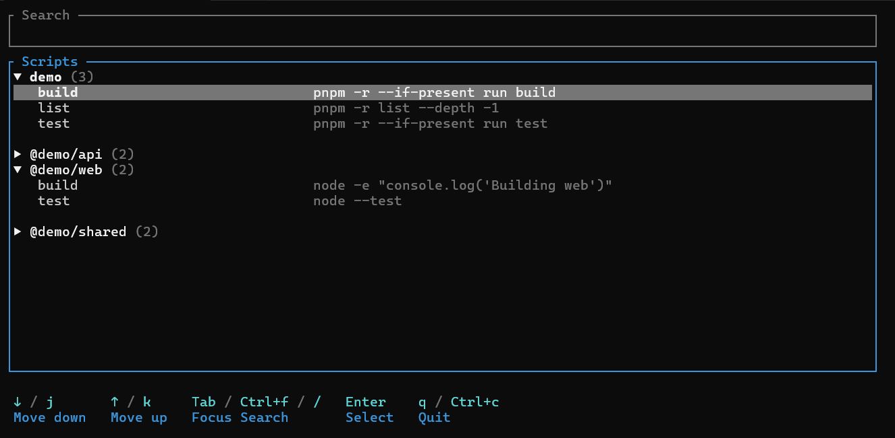

<!-- # nrun
i cant remember what the npm scripts are called -->

<h1 align="center">nrun</h1>

<p align="center">
  <em>I can't remember what the npm scripts are called</em>
</p>

<!--  -->

<!-- Badges -->

<p align="center">
  <a href="#compatibility">
    
  </a>
  <a href="#compatibility">
    
  </a>
  <a href="LICENSE">
    
  </a>
  <a href="https://github.com/sondre4/nrun/actions/workflows/ci.yml">
    
  </a>
  <a href="https://github.com/sondre4/nrun/releases/latest">
    
  </a>
</p>

<!-- Demo image -->

<p align="center">
  
</p>

## Features
- TUI
  - Browse project-defined scripts from all packages in e.g. a Node monorepo
  - Run selected script by pressing `Enter`
  - Expand/collapse selected package by pressing `Enter`
  - Search for package/script names

- CLI
  - Display all project-defined scripts in e.g. a Node monorepo
  - Search scripts from the command line
  - Output formatted packages/scripts overview
  - Optional JSON output format
  - Run `nrun --help` for more information

## Compatibility
- Works with **npm**, **Bun**, **Yarn**, and **pnpm**
- Works for Node **projects** and **monorepos**
- Runs natively on **Linux**, **macOS** and **Windows**.

#### Package-manager specifics tested
- Project and monorepo discovery for **npm**, **Bun**, **Yarn**, and **pnpm**
- Running project-defined scripts
- Tested on Linux, macOS and Windows in CI

## Installation

Download the latest release for your operating system and CPU architecture from the GitHub Releases page.

Precompiled binaries are available for:

| Platform | Architecture | Archive |
| --- | --- | --- |
| Linux | x86-64 | `.tar.gz` |
| Linux | ARM64 | `.tar.gz` |
| macOS | Intel (x86-64) | `.tar.gz` |
| macOS | Apple Silicon (ARM64) | `.tar.gz` |
| Windows | x86-64 | `.zip` |
| Windows | ARM64 | `.zip` |

Replace the release link above with the actual repository URL.

### macOS and Linux

1. Download the archive matching your operating system and architecture from the latest release.
2. Extract the archive.
3. Move the `nrun` binary into a directory on your `PATH`.

For example, to install it in `~/.local/bin`:

```
mkdir -p ~/.local/bin
tar -xzf nrun-<version>-<target>.tar.gz
install -m 755 nrun ~/.local/bin/nrun
```

Replace `<version>` and `<target>` with the values in the downloaded archive's filename.

If `~/.local/bin` is not already on your `PATH`, add it to your shell configuration.

For **Bash** or **Zsh**, add this line to `~/.bashrc`, `~/.bash_profile`, or `~/.zshrc`, as appropriate:

```
export PATH="$HOME/.local/bin:$PATH"
```

For **Fish**, run:

```
fish_add_path ~/.local/bin
```

Open a new terminal, or reload the relevant shell configuration file.

Verify the installation:

```
nrun --version
nrun --help
```

### Windows

1. Download the Windows archive matching your CPU architecture.
2. Extract the ZIP archive.
3. Move `nrun.exe` into a permanent directory, for example:

```
%LOCALAPPDATA%\Programs\nrun\
```

4. Add that directory to your user `PATH`.

To update `PATH`, open **Settings**, search for _Edit environment variables for your account_, select the `Path` user variable, and add the installation directory.

Open a new terminal and verify the installation:

```
nrun.exe --version
nrun.exe --help
```

You can also invoke it as `nrun` in PowerShell once the directory is on `PATH`.

### Verify checksums (optional)

Release archives include SHA-256 checksums in the `SHA256SUMS` file. Download this file alongside your chosen archive to verify the download's integrity.

On Linux or macOS, if you have downloaded `SHA256SUMS` and the corresponding archive into the same directory, run:

```
sha256sum -c SHA256SUMS
```

On Windows, compare the archive's SHA-256 hash with the corresponding entry in `SHA256SUMS` using PowerShell:

```
Get-FileHash .\nrun-<version>-<target>.zip -Algorithm SHA256
```

The calculated hash should match the value published for that archive.

### Updating

To update to a newer version, download the new release archive and replace the existing binary in your installation directory. You do not need to change your `PATH` again if you keep the same installation directory.

### Uninstalling

Remove the `nrun` binary from the installation directory. If you added a dedicated directory to your `PATH` solely for this tool, you can remove that directory from your shell configuration or environment variables as well.


### Build from source

You can build `nrun` yourself if you have a Rust toolchain installed.

1. Install Rust using [rustup](<https://rustup.rs/>).
2. Clone the repository and enter its directory.
3. Build the optimized binary with Cargo.

```
git clone https://github.com/sondre4/nrun.git
cd nrun
cargo build --release --locked
```

The resulting binary is located at `target/release/nrun` on Linux and macOS, or `target/release/nrun.exe` on Windows. Move the binary into a directory on your `PATH` to make it available from any directory.

## Development

### Prerequisites

- [Rust and Cargo](<https://rustup.rs/>)
- Git

### Useful commands
#### Formatting
```
cargo fmt --all -- --check
```

Format code automatically
```
cargo fmt --all
```

#### Linting
```
cargo clippy --all-targets --all-features -- -D warnings
```

#### Tests
> [!IMPORTANT]
> **npm**, **bun**, **yarn**, and **pnpm** are called during integration tests. If they are not available in the test environment, the integration tests will fail.

```
cargo test --locked --all-targets
```

#### Build

Build a debug version:

```
cargo build
```

Build an optimized release version:

```
cargo build --locked --release
```

The resulting binary is located in `target/release/`

#### Run locally

Run it directly through Cargo:

```
cargo run -- --help
```

Pass additional CLI arguments after `--`:

```
cargo run -- <arguments>
```

### Recommended local checks
```
cargo fmt --all -- --check
cargo clippy --all-targets --all-features -- -D warnings
cargo test --locked --all-targets
```
